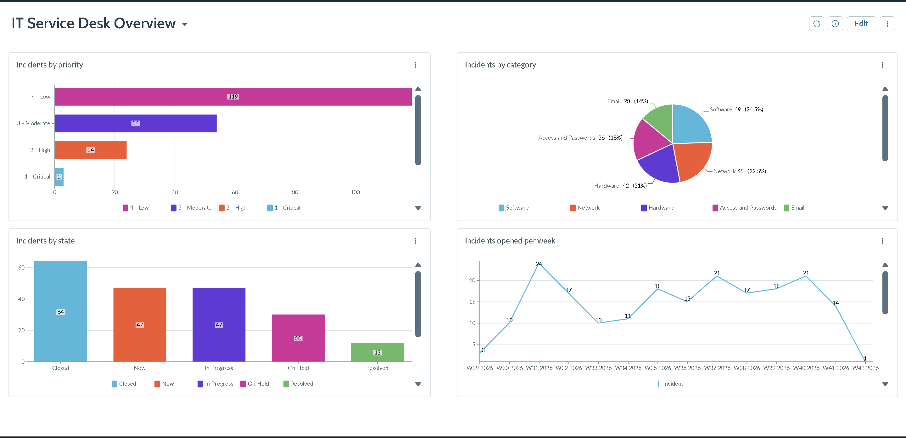
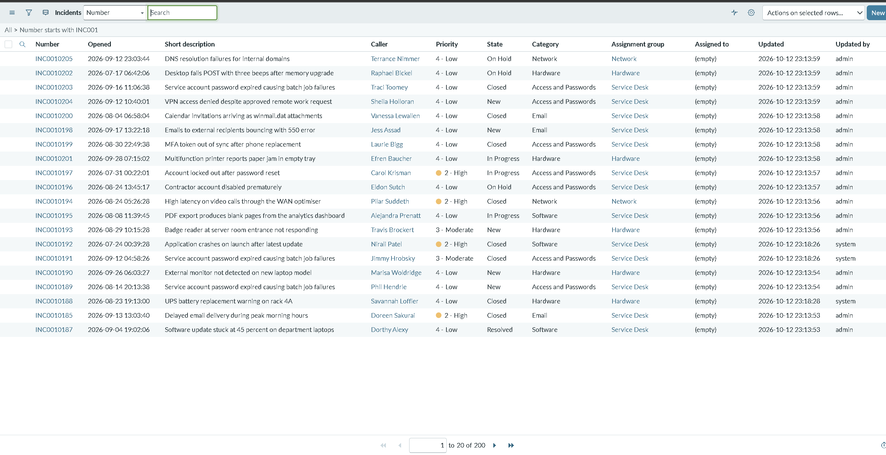
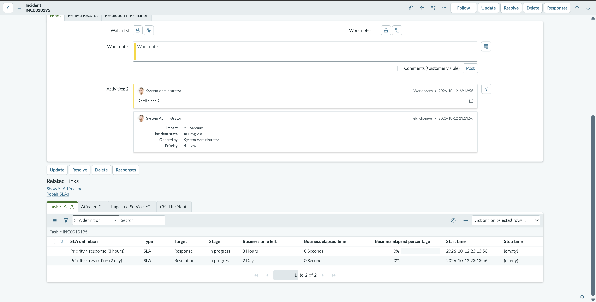
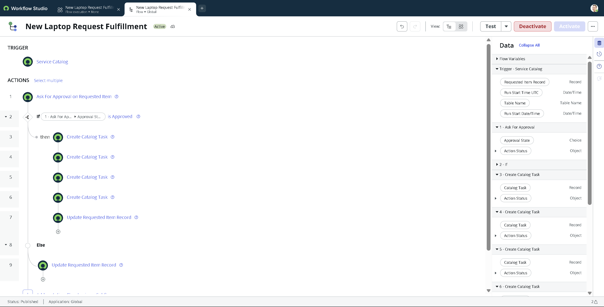
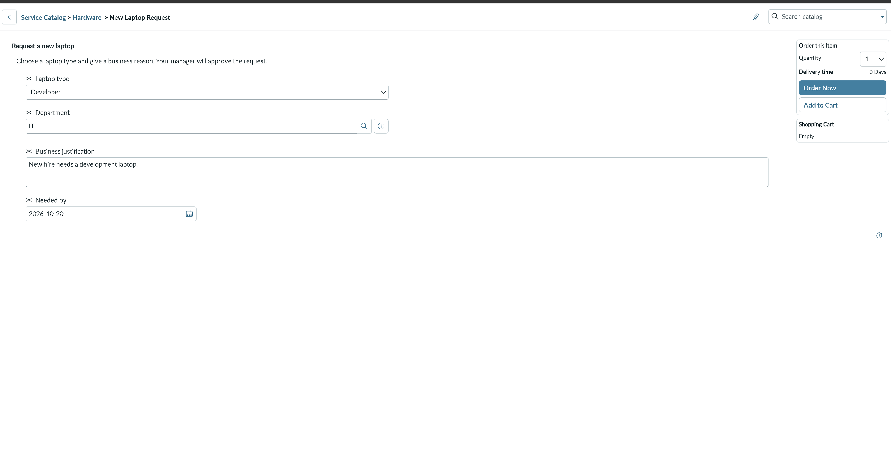
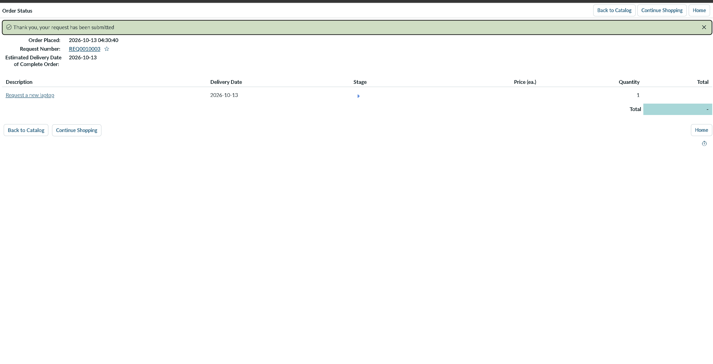
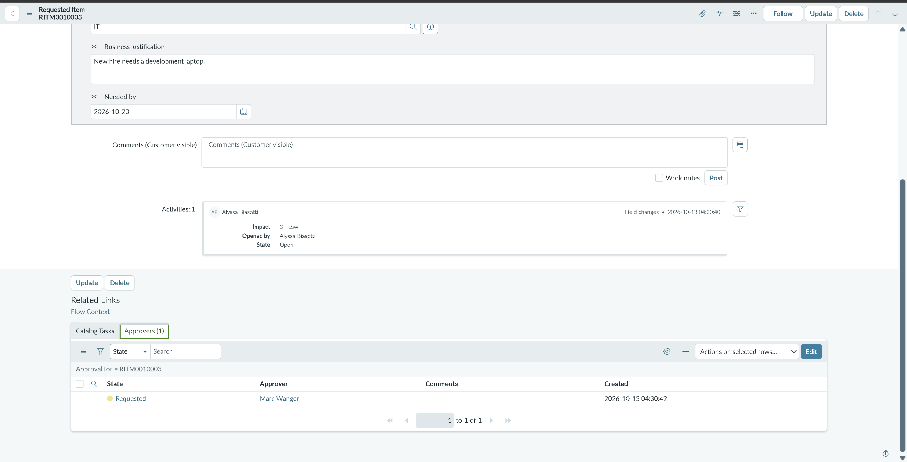
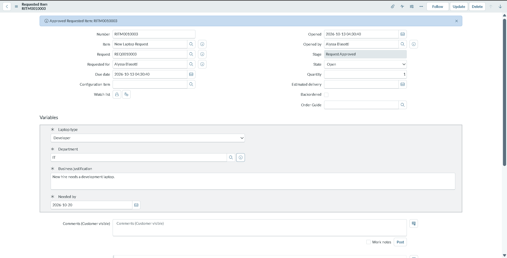
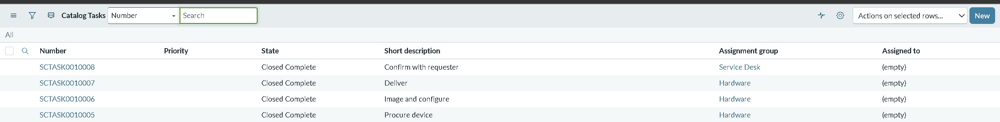
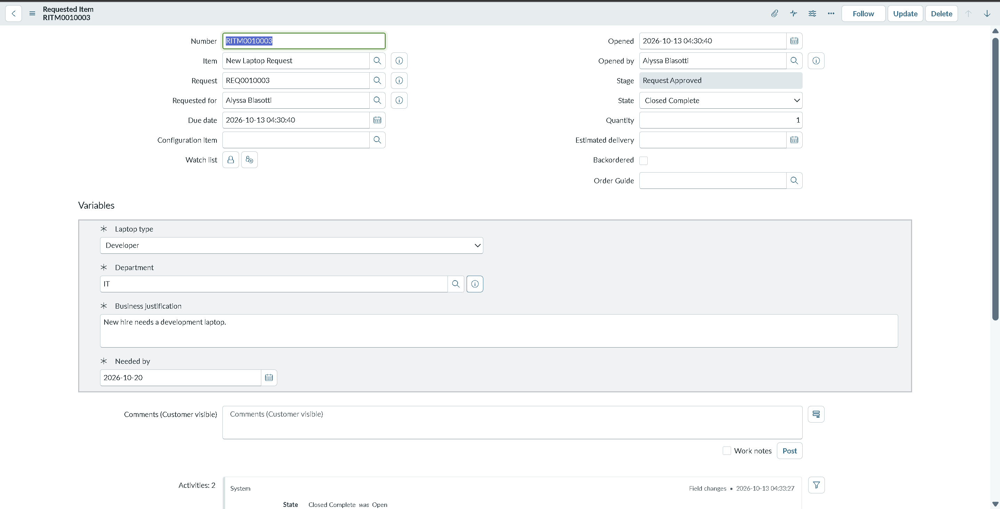

# ServiceNow ITSM Service Desk

A hands-on ITSM project on a ServiceNow Personal Developer Instance (Australia release), in two parts:

1. A scripted, verified set of 200 synthetic incidents and a four-chart Platform Analytics dashboard built on top of it.
2. A Service Catalog item, **New Laptop Request**, with a manager approval and a four-step fulfillment flow.

Solo project, built October 2026.

## What this project shows

- Generating realistic incident data with a GlideRecord background script, including a dry-run mode and a cleanup tag.
- Letting the platform calculate priority from impact and urgency instead of hardcoding it.
- Verifying the result with read-only scripts before building reports.
- Building reports and a dashboard in Platform Analytics.
- Building a catalog item with mandatory variables and a flow in Workflow Studio: approval, branching, sequential fulfillment tasks, and closing the request.
- Testing the flow end to end as a requester and an approver, and fixing what the tests exposed.

## Part 1: Incident data and dashboard

### Data: synthetic

All 200 incidents are synthetic demo data created by `scripts/seed_incidents.js`. They do not represent real incident volume or real service desk performance. Every record carries the tag `DEMO_SEED` in its work notes.

| Property | Value |
|---|---|
| Records | 200 |
| Categories | Software, Network, Hardware, Access and Passwords, Email |
| Assignment groups | Service Desk, Network, Hardware |
| Opened dates | Spread randomly over the previous 90 days |
| States | New, In Progress, On Hold, Resolved, Closed |
| Priority | Calculated by the platform from impact and urgency |

### Dashboard

Four charts, all built on the Incident table with the filter `Number starts with INC001`:

1. Incidents by priority (bar): Low 119, Moderate 54, High 24, Critical 3
2. Incidents by category (pie): Software 49, Network 45, Hardware 42, Access and Passwords 36, Email 28
3. Incidents by state (bar): Closed 64, New 47, In Progress 47, On Hold 30, Resolved 12
4. Incidents opened per week (line): 14 weekly points, peaking at 24 in week 31 (the week of 2026-07-27)

Counts are as of the screenshot date. Resolved and Closed shift slightly over time as the platform processes records.

The seeded incident list (200 records, filtered to the demo data):

One incident with its SLA tab, showing the SLA timers that were attached when the record was inserted:

### How the data was generated

1. Added two category choices to the incident category list: `access` (Access and Passwords) and `email` (Email).
2. Ran the seed script with `DRY_RUN = true` and checked the log.
3. Ran it live with `TOTAL = 5`, inspected the records, and deleted them.
4. Ran it once with `TOTAL = 200`.
5. Ran `scripts/verify_seed.js` to check the results.

Design decisions in the script:

- Priority is never set by the script. The platform calculates it.
- `opened_at` is backdated. Resolved dates fall after opened dates, and closed dates fall after resolved dates.
- Resolved and Closed records have a close code and close notes.
- Assignment groups are limited to three relevant groups, matched to category.
- A `DRY_RUN` flag, set to true by default, logs what would be created without inserting anything.

### Verification

`scripts/verify_seed.js` is read-only. Results from the run:

- 200 incidents created
- Only the three intended assignment groups used
- 0 incidents resolved before they were opened
- 0 resolved or closed incidents missing close notes

### Known limitations

- SLA timers on seeded incidents start when the records were inserted, not at the backdated opened date. SLA breach reporting on this data is not meaningful, so the dashboard does not include it.
- Resolution times in this dataset come from random dates, so average resolution time is not a meaningful metric here.
- The first and last points on the weekly chart are partial weeks, because the data covers 90 days back from the day it was created.

### How to run

1. Request a Personal Developer Instance at developer.servicenow.com.
2. Add the two category choices described above.
3. Open Scripts - Background and paste `seed_incidents.js`. Run it with `DRY_RUN = true`, then with `TOTAL = 5` and `DRY_RUN = false`, then with `TOTAL = 200`.
4. Run `verify_seed.js`.
5. Build the four reports and add them to a dashboard in Platform Analytics.

## Part 2: New Laptop Request (Service Catalog)

A catalog item with an approval and fulfillment flow on the same instance. All users and records are demo data.

### What it does

1. A user orders **New Laptop Request** from the Hardware category.
2. The form collects four mandatory variables: Laptop type (Standard, Developer, High performance), Department, Business justification, and Needed by.
3. The flow **New Laptop Request Fulfillment** (Workflow Studio, global scope) asks the requester's manager for approval.
4. If the request is approved, the flow creates four catalog tasks, one at a time: Procure device, Image and configure, Deliver (Hardware group), and Confirm with requester (Service Desk group). Each task is created after the previous one is closed.
5. When the last task closes, the flow sets the requested item to Closed Complete.
6. If the request is not approved, an Else branch updates the requested item record.

### Test run

REQ0010003 was submitted as a demo user (Developer laptop, IT department).

The order form with the four variables filled in:

The submitted request:

The flow created an approval for the demo manager, and the request waited on it:

After approval, the requested item moved on and the flow created the fulfillment tasks:

All four tasks, closed in order:

The requested item then closed as complete. The activity log shows the state change was made by the system, not by hand:

### Notes

- The demo requester's manager field was set manually, because the default demo users have no manager.
- The demo manager account has no roles, so the approval was completed by the admin account on behalf of the manager. The approval record still shows the manager as the approver.
- Two earlier test requests are not shown in the screenshots. REQ0010001 was approved automatically with no approver, because the requester had no manager, which is why the manager was set. REQ0010002 ran before the closing step was added to the flow, so its requested item stayed open.
- The Else branch (request not approved) is built but was not tested.
- Tasks were closed by hand to move the flow forward. No timing or SLA metrics are reported for this item.
- Flow reporting was off during the test runs, so the flow execution page shows no per-step state or duration.

## Repository contents

| Path | Purpose |
|---|---|
| `scripts/seed_incidents.js` | Creates the demo incidents (Scripts - Background) |
| `scripts/verify_seed.js` | Read-only checks on the created data |
| `scripts/cleanup_seed.js` | Deletes the demo incidents (dry run by default) |
| `screenshots/` | Dashboard, incident, and catalog item screenshots |

The catalog item and its flow were built in the instance UI, so they have no script in this repository. The screenshots show the configuration and the test run.

## Planned next steps

These are not built yet:

- A small knowledge base
- Role-based access with ACLs
